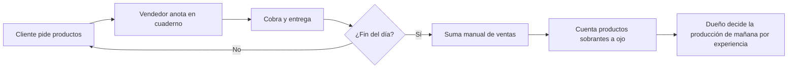
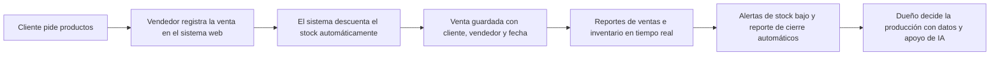
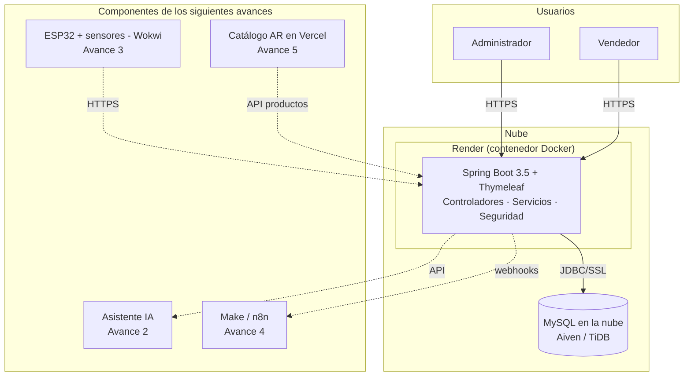
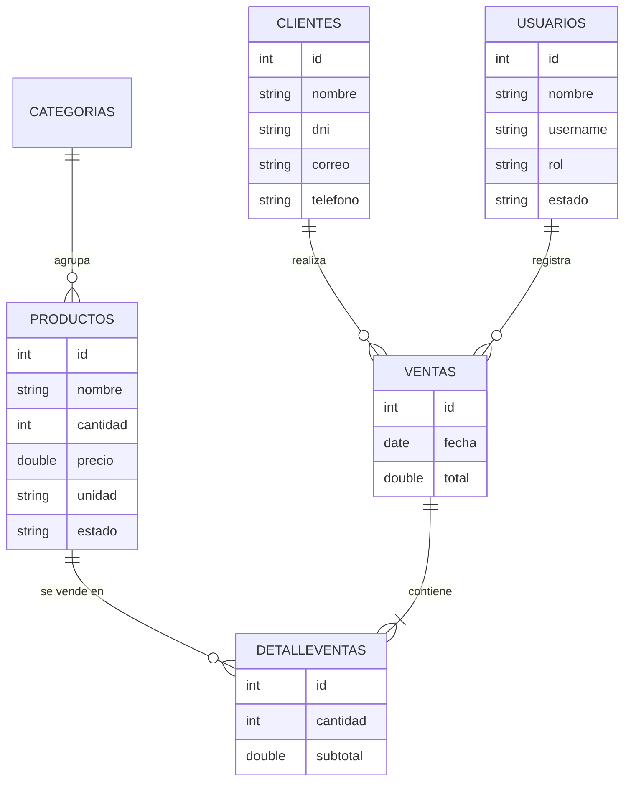
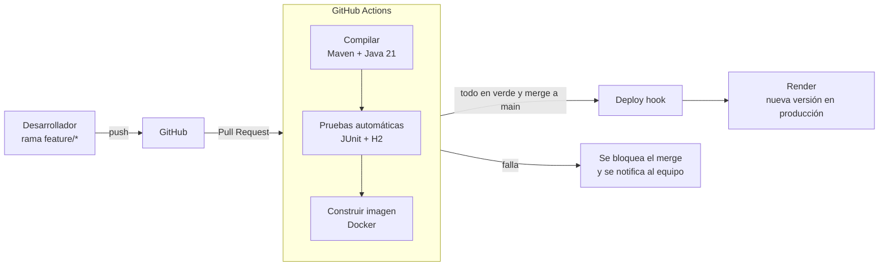

# Avance 1 – Diseño Inicial de la Solución y Arquitectura DevOps

**Proyecto:** Transformación digital de la Panadería Pastelería Los Andes
**Curso:** Herramientas de Desarrollo Profesional TIC
**Sector:** Comercio (producción y venta de panadería y pastelería)
**Integrantes:** _[completar]_

> Borrador base. Los textos entre corchetes `[...]` deben completarse con datos reales de la panadería (entrevista al dueño, observación del proceso).

---

## 1. Diagnóstico del problema

### 1.1 Contexto de la organización

La Panadería Pastelería Los Andes produce y vende panes, tortas y pasteles al público. Atiende ventas en mostrador y pedidos de tortas, y maneja un inventario de productos terminados que se renueva diariamente. _[Completar: ubicación, años de funcionamiento, número de trabajadores, volumen aproximado de ventas diarias.]_

### 1.2 Problemática identificada

| # | Problema | Consecuencia |
|---|---|---|
| P1 | Las ventas se registran de forma manual (cuaderno o boletas sueltas). | Cierre de caja lento y propenso a errores; no hay historial confiable. |
| P2 | El stock de productos se controla "a ojo". | Productos agotados sin aviso o sobreproducción que termina en merma. |
| P3 | No existen reportes de ventas por producto, categoría o vendedor. | El dueño decide qué y cuánto producir sin datos. |
| P4 | No hay control de acceso ni trazabilidad de quién vendió qué. | Dificultad para detectar faltantes o errores de caja. |
| P5 | Los datos de clientes que encargan tortas no se guardan. | No se pueden hacer promociones ni seguimiento a clientes frecuentes. |

**Problema central:** la panadería gestiona sus ventas e inventario de forma manual, lo que provoca pérdida de información, errores de stock y decisiones de producción sin sustento en datos.

## 2. Objetivos y alcance

### 2.1 Objetivo general

Diseñar e implementar una solución de transformación digital para la Panadería Pastelería Los Andes que automatice la gestión de ventas e inventario e integre tecnologías emergentes (DevOps, IA, IoT, automatización y realidad aumentada) para mejorar la toma de decisiones.

### 2.2 Objetivos específicos

1. Implementar un sistema web en la nube para registrar ventas, clientes, productos y usuarios con control de acceso por roles.
2. Establecer un pipeline CI/CD que compile, pruebe y despliegue automáticamente cada cambio.
3. Incorporar un asistente de IA que responda consultas sobre ventas y sugiera la producción diaria (Avance 2).
4. Monitorear con sensores IoT la temperatura de fermentación y del horno, y el nivel de insumos (Avance 3).
5. Automatizar reportes de cierre y alertas de reposición con herramientas No-Code/Low-Code (Avance 4).
6. Ofrecer un catálogo de tortas en realidad aumentada para los clientes (Avance 5).

### 2.3 Alcance

| Incluye | No incluye |
|---|---|
| Ventas en mostrador, clientes, inventario de productos terminados, reportes, usuarios | Facturación electrónica ante SUNAT |
| Despliegue en la nube con CI/CD | Pagos en línea |
| Integración progresiva de IA, IoT, RPA y AR | Aplicación móvil nativa |

## 3. Análisis AS-IS y TO-BE

### 3.1 Proceso actual (AS-IS)

**Puntos de dolor:** registro manual, suma manual, conteo visual de stock, sin datos históricos.

### 3.2 Proceso propuesto (TO-BE)

### 3.3 Comparación de indicadores

| Indicador | AS-IS | TO-BE (esperado) |
|---|---|---|
| Tiempo de cierre de caja | _[medir, ej. minutos]_ | Inmediato (reporte automático) |
| Errores en el conteo de stock | _[medir]_ | Stock actualizado en cada venta |
| Disponibilidad de reportes | No existen | Por fecha, categoría y vendedor (PDF, Excel, CSV) |
| Trazabilidad de ventas | Nula | Cada venta asociada a un vendedor y cliente |

## 4. Arquitectura preliminar

### 4.1 Capas del sistema

| Capa | Componentes |
|---|---|
| Presentación | Vistas Thymeleaf, Bootstrap 5, JavaScript (fetch) |
| Controladores | `HomeController`, `VentasController`, `ProductoController`, `UsuarioController`, `ReporteVentaController`, `ReporteController` |
| Servicios | Lógica de ventas, productos, usuarios, reportes y exportación |
| Persistencia | Spring Data JPA / Hibernate |
| Datos | MySQL: `categorias`, `productos`, `clientes`, `usuarios`, `ventas`, `detalleventas` |
| Seguridad | Spring Security, roles ADMIN y VENDEDOR, contraseñas BCrypt |

### 4.2 Modelo de datos

## 5. Propuesta de pipeline CI/CD

| Etapa | Herramienta | Qué valida |
|---|---|---|
| Control de versiones | Git + GitHub (ramas y Pull Requests) | Trabajo colaborativo y revisión de código |
| Integración continua | GitHub Actions | Que el proyecto compile en cada cambio |
| Pruebas automáticas | JUnit 5, Mockito, Spring Security Test, H2 | Reglas de negocio y permisos por rol |
| Empaquetado | Docker (imagen multi-etapa) | Que la aplicación se ejecute igual en cualquier entorno |
| Despliegue continuo | Render (deploy hook) | Publicación automática solo si todo pasó |
| Entorno de desarrollo en la nube | GitHub Codespaces + Docker Compose | Todos trabajan con el mismo entorno |

### 5.1 Pruebas automáticas incluidas

| Prueba | Verifica |
|---|---|
| `UsuarioServiceTest` | Las contraseñas se cifran al crear y no se vuelven a cifrar al editar; se rechazan roles inválidos |
| `SeguridadTest` | Un vendedor no puede administrar usuarios ni descargar reportes; sin sesión se redirige al login |
| `VentasControllerTest` | Registrar una venta descuenta el stock y no expone la contraseña del vendedor |
| `ExcelExportServiceTest` | El Excel de productos se genera con encabezados y datos correctos |

### 5.2 Beneficios esperados de DevOps

- **Calidad:** ningún cambio llega a producción sin compilar y pasar las pruebas.
- **Velocidad:** el despliegue pasa de manual a automático.
- **Colaboración:** cada integrante trabaja en su rama y el pipeline valida su aporte.
- **Reproducibilidad:** Docker garantiza el mismo entorno en local, Codespaces y la nube.

## 6. Referencias

- Spring Boot Reference Documentation. https://docs.spring.io/spring-boot/
- GitHub Actions Documentation. https://docs.github.com/actions
- Docker Documentation. https://docs.docker.com/
- Render Documentation. https://render.com/docs
- Kim, G., Humble, J., Debois, P., & Willis, J. (2016). *The DevOps Handbook*. IT Revolution Press.
