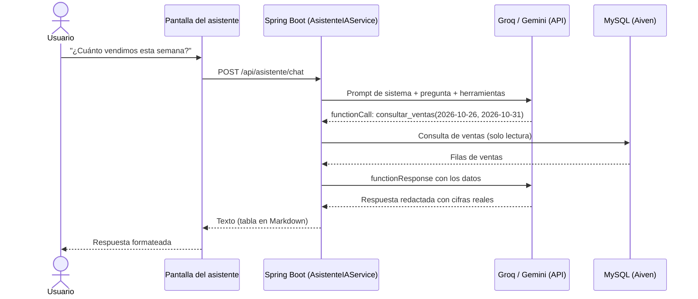

# Avance 2 – Inteligencia Artificial y Prompt Engineering

**Proyecto:** Transformación digital de la Panadería Pastelería Los Andes
**Curso:** Herramientas de Desarrollo Profesional TIC
**Integrantes:** _[completar]_

---

## 1. Problema que aborda la IA

En el Avance 1 se digitalizaron las ventas y el inventario. Sin embargo, el dueño y los vendedores todavía necesitan **interpretar** esos datos para decidir. Hoy eso exige abrir reportes, filtrar y calcular a mano. Tres decisiones diarias siguen dependiendo de la intuición:

1. **¿Cuánto producir mañana?** Producir de más genera merma; producir de menos, ventas perdidas.
2. **¿Cómo van las ventas?** Responder preguntas simples ("¿cuánto pan francés vendimos ayer?") requiere varios pasos en los reportes.
3. **¿Qué promocionar hoy?** No se aprovecha el stock alto para publicar ofertas en redes sociales.

## 2. Casos de uso de IA

| # | Caso de uso | Usuario | Valor para la panadería | Técnica |
|---|---|---|---|---|
| CU1 | Consultas de ventas e inventario en lenguaje natural | Dueño, vendedores | Respuestas inmediatas sin navegar reportes | Zero-shot + tool use |
| CU2 | Plan de producción del día siguiente | Dueño, maestro panadero | Menos merma y menos quiebres de stock | Few-shot + tool use |
| CU3 | Promoción del día para WhatsApp y Facebook | Dueño | Marketing diario sin esfuerzo, rota el stock alto | One-shot + tool use |

## 3. Solución: "Asistente Los Andes"

Asistente conversacional integrado en el sistema web (menú **Asistente IA**), disponible para administradores y vendedores.

### 3.1 Componentes

| Componente | Archivo | Función |
|---|---|---|
| Pantalla de chat | `templates/vista/asistente.html`, `static/js/asistente.js` | Conversación, botones de acciones rápidas, render seguro de tablas |
| Controlador | `controllers/AsistenteController.java` | `GET /principal/asistente` y `POST /api/asistente/chat` |
| Servicio de IA | `services/AsistenteIAService.java` | Elige el proveedor (Groq o Gemini) y ejecuta el ciclo de *function calling* (`services/ia/`) |
| Herramientas | `services/HerramientasAsistente.java` | `consultar_ventas` y `consultar_inventario` (solo lectura) |
| Banco de prompts | `services/PromptsAsistente.java` y [`banco_prompts.md`](banco_prompts.md) | Prompts zero-shot, few-shot y one-shot |

### 3.2 Selección tecnológica

| Decisión | Elección | Justificación |
|---|---|---|
| Proveedor principal | **Groq** (API compatible con OpenAI) | Plan gratuito sin tarjeta, con más consultas diarias que Gemini y respuestas muy rápidas (hardware LPU) |
| Proveedor alternativo | **Google Gemini** (SDK oficial `google-genai`) | También gratuito; se activa cambiando una variable de entorno si se agota la cuota de Groq |
| Modelo | `openai/gpt-oss-120b` en Groq (configurable con `GROQ_MODEL`) | Modelo abierto con buen uso de herramientas; si Groq lo retira, el sistema elige automáticamente otro modelo disponible |
| Acceso a datos | *Function calling* (uso de herramientas) | La IA obtiene cifras reales; no se le entregan tablas completas ni puede ejecutar SQL |
| Arquitectura | Interfaz `ProveedorIA` con dos implementaciones (`GroqProveedor`, `GeminiProveedor`) | Los prompts y las herramientas son los mismos; cambiar de proveedor no requiere modificar código |

**Lección aprendida (iteración):** la primera versión usó Gemini, pero su plan gratuito para el modelo Flash más reciente permite solo **5 consultas por minuto y 20 por día**, y cada pregunta consume al menos 2 (pedido de datos + respuesta). La cuota se agotó durante las pruebas, por lo que se incorporó Groq como proveedor principal manteniendo Gemini como respaldo.

## 4. Diseño de prompts

Detallado en el [Banco de Prompts](banco_prompts.md). Resumen:

| Técnica | Dónde se aplica | Cómo |
|---|---|---|
| **Zero-shot** | Chat libre (CU1) | Rol + reglas + herramientas, sin ejemplos |
| **Few-shot** | Plan de producción (CU2) | 3 ejemplos: día normal, fin de semana y sin datos |
| **One-shot** | Promoción del día (CU3) | 1 ejemplo que fija estilo, longitud y estructura |
| Prompt de rol | Todos | "Eres Asistente Los Andes…" |
| Restricciones explícitas | Todos | No inventar cifras, solo lectura, temas del negocio |
| Contexto dinámico | Todos | Fecha actual de Lima en el prompt |

## 5. Viabilidad

| Aspecto | Análisis |
|---|---|
| **Técnica** | Integrado al sistema existente sin cambiar la base de datos; usa el SDK oficial. Validado con 9 pruebas automáticas (herramientas y controlador) y con una simulación completa del ciclo de herramientas. |
| **Económica** | **Costo cero**: se usan los planes gratuitos de Groq y Gemini. Tiene límites de consultas por minuto y por día (ver Google AI Studio), suficientes para el uso de la panadería y la demostración; si se superan, el asistente avisa y se puede reintentar más tarde. Si el negocio creciera, bastaría activar la facturación sin cambiar código. |
| **Seguridad y privacidad** | API key solo como variable de entorno en Render (nunca en GitHub); herramientas de solo lectura; requiere sesión iniciada; el texto de la IA se muestra escapado (sin riesgo de inyección de HTML). En el plan gratuito Google puede usar los datos enviados para mejorar sus productos (revisar los términos vigentes): solo se envían resúmenes de ventas e inventario, nunca datos personales de clientes ni contraseñas. |
| **Operativa** | Si la IA no está configurada o falla, el resto del sistema sigue funcionando y el asistente muestra un mensaje claro. |
| **Limitaciones** | Depende de la calidad de los datos registrados; las respuestas deben verificarse con los reportes para decisiones importantes; requiere conexión a internet. |

## 6. Prototipo

- **Pantalla:** https://sistema-panaderia-los-andes.onrender.com/principal/asistente
- _[Insertar capturas: consulta zero-shot con tabla, plan de producción y promoción del día.]_

## 7. Configuración

Variables de entorno en Render (*Environment*):

| Variable | Valor |
|---|---|
| `GROQ_API_KEY` | API key gratuita creada en https://console.groq.com (*API Keys*) |
| `GROQ_MODEL` | Opcional. Por defecto `openai/gpt-oss-120b` |
| `GEMINI_API_KEY` | Alternativa: API key gratuita de https://aistudio.google.com |
| `IA_PROVEEDOR` | Opcional. `groq`, `gemini` o `auto` |
| `GEMINI_MODEL` | Opcional. Por defecto `gemini-flash-latest` |
| `GEMINI_THINKING` | Opcional. `MINIMAL`, `LOW` (por defecto), `MEDIUM` o `HIGH`. Menos razonamiento = respuestas más rápidas |

## 8. Referencias

- Groq. *Tool Use*. https://console.groq.com/docs/tool-use
- Google. *Gemini API – Function calling*. https://ai.google.dev/gemini-api/docs/function-calling
- Google. *Gemini API – Prompt design strategies*. https://ai.google.dev/gemini-api/docs/prompting-strategies
- Brown, T. et al. (2020). *Language Models are Few-Shot Learners*. NeurIPS.
