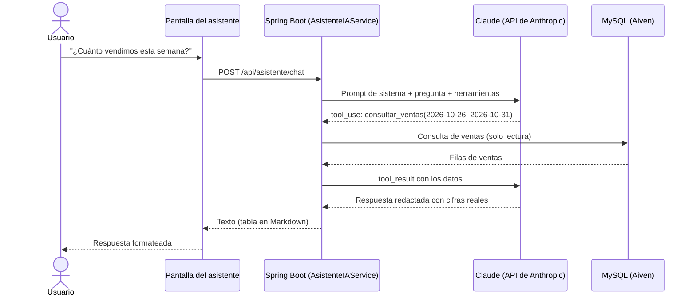

# Avance 2 – Inteligencia Artificial y Prompt Engineering

**Proyecto:** Transformación digital de la Panadería Pastelería Los Andes
**Curso:** Herramientas de Desarrollo Profesional TIC
**Integrantes:** _[completar]_

---

## 1. Problema que aborda la IA

En el Avance 1 se digitalizaron las ventas y el inventario. Sin embargo, el dueño y los vendedores todavía necesitan **interpretar** esos datos para decidir. Hoy eso exige abrir reportes, filtrar y calcular a mano. Tres decisiones diarias siguen dependiendo de la intuición:

1. **¿Cuánto producir mañana?** Producir de más genera merma; producir de menos, ventas perdidas.
2. **¿Cómo van las ventas?** Responder preguntas simples ("¿cuánto pan francés vendimos ayer?") requiere varios pasos en los reportes.
3. **¿Qué promocionar hoy?** No se aprovecha el stock alto para publicar ofertas en redes sociales.

## 2. Casos de uso de IA

| # | Caso de uso | Usuario | Valor para la panadería | Técnica |
|---|---|---|---|---|
| CU1 | Consultas de ventas e inventario en lenguaje natural | Dueño, vendedores | Respuestas inmediatas sin navegar reportes | Zero-shot + tool use |
| CU2 | Plan de producción del día siguiente | Dueño, maestro panadero | Menos merma y menos quiebres de stock | Few-shot + tool use |
| CU3 | Promoción del día para WhatsApp y Facebook | Dueño | Marketing diario sin esfuerzo, rota el stock alto | One-shot + tool use |

## 3. Solución: "Asistente Los Andes"

Asistente conversacional integrado en el sistema web (menú **Asistente IA**), disponible para administradores y vendedores.

### 3.1 Componentes

| Componente | Archivo | Función |
|---|---|---|
| Pantalla de chat | `templates/vista/asistente.html`, `static/js/asistente.js` | Conversación, botones de acciones rápidas, render seguro de tablas |
| Controlador | `controllers/AsistenteController.java` | `GET /principal/asistente` y `POST /api/asistente/chat` |
| Servicio de IA | `services/AsistenteIAService.java` | Llama a Claude con el SDK oficial y ejecuta el ciclo de herramientas |
| Herramientas | `services/HerramientasAsistente.java` | `consultar_ventas` y `consultar_inventario` (solo lectura) |
| Banco de prompts | `services/PromptsAsistente.java` y [`banco_prompts.md`](banco_prompts.md) | Prompts zero-shot, few-shot y one-shot |

### 3.2 Selección tecnológica

| Decisión | Elección | Justificación |
|---|---|---|
| Modelo | Claude Opus 5.5 (`claude-opus-5-5`), configurable con `ANTHROPIC_MODEL` | Modelo actual de Anthropic con buen razonamiento para cálculos (plan de producción) y uso de herramientas |
| Integración | SDK oficial `anthropic-java` 3.2.0 | Tipado, reintentos automáticos y manejo de errores incluidos |
| Acceso a datos | *Tool use* (function calling) | La IA obtiene cifras reales; no se le entregan tablas completas ni puede ejecutar SQL |
| Esfuerzo de razonamiento | `medium` (configurable con `ANTHROPIC_EFFORT`) | Balance entre calidad y costo para consultas cotidianas |
| Rechazos | `fallbacks: "default"` | Si el modelo rechaza una solicitud legítima, la API la reintenta con el modelo alternativo recomendado |

## 4. Diseño de prompts

Detallado en el [Banco de Prompts](banco_prompts.md). Resumen:

| Técnica | Dónde se aplica | Cómo |
|---|---|---|
| **Zero-shot** | Chat libre (CU1) | Rol + reglas + herramientas, sin ejemplos |
| **Few-shot** | Plan de producción (CU2) | 3 ejemplos: día normal, fin de semana y sin datos |
| **One-shot** | Promoción del día (CU3) | 1 ejemplo que fija estilo, longitud y estructura |
| Prompt de rol | Todos | "Eres Asistente Los Andes…" |
| Restricciones explícitas | Todos | No inventar cifras, solo lectura, temas del negocio |
| Contexto dinámico | Todos | Fecha actual de Lima en el prompt |

## 5. Viabilidad

| Aspecto | Análisis |
|---|---|
| **Técnica** | Integrado al sistema existente sin cambiar la base de datos; usa el SDK oficial. Validado con 9 pruebas automáticas (herramientas y controlador) y con una simulación completa del ciclo de herramientas. |
| **Económica** | Pago por uso de la API. Cada consulta procesa unos pocos miles de tokens; el costo por consulta es de centavos de dólar. Se puede reducir aún más cambiando a `claude-haiku-5-5` mediante la variable `ANTHROPIC_MODEL`, sin tocar código. |
| **Seguridad** | API key solo como variable de entorno en Render (nunca en GitHub); herramientas de solo lectura; requiere sesión iniciada; el texto de la IA se muestra escapado (sin riesgo de inyección de HTML). |
| **Operativa** | Si la IA no está configurada o falla, el resto del sistema sigue funcionando y el asistente muestra un mensaje claro. |
| **Limitaciones** | Depende de la calidad de los datos registrados; las respuestas deben verificarse con los reportes para decisiones importantes; requiere conexión a internet. |

## 6. Prototipo

- **Pantalla:** https://sistema-panaderia-los-andes.onrender.com/principal/asistente
- _[Insertar capturas: consulta zero-shot con tabla, plan de producción y promoción del día.]_

## 7. Configuración

Variables de entorno en Render (*Environment*):

| Variable | Valor |
|---|---|
| `ANTHROPIC_API_KEY` | API key creada en https://console.anthropic.com |
| `ANTHROPIC_MODEL` | Opcional. Por defecto `claude-opus-5-5` |
| `ANTHROPIC_EFFORT` | Opcional. `low`, `medium` (por defecto) o `high` |

## 8. Referencias

- Anthropic. *Claude API Documentation – Tool use*. https://docs.claude.com
- Anthropic. *Prompt engineering overview*. https://docs.claude.com
- Brown, T. et al. (2020). *Language Models are Few-Shot Learners*. NeurIPS.
