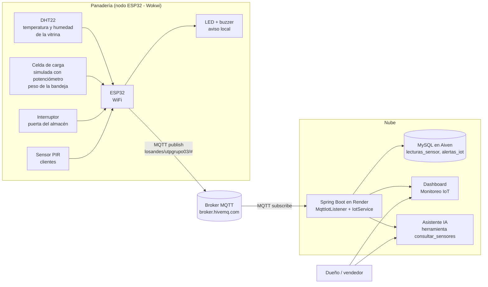
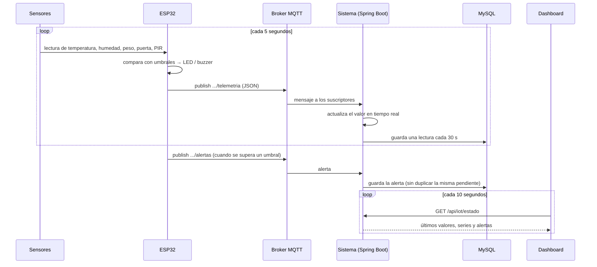

# Avance 3 – Solución IoT

**Proyecto:** Transformación digital de la Panadería Pastelería Los Andes
**Curso:** Herramientas de Desarrollo Profesional TIC
**Integrantes:** _[completar]_ (Grupo 03)

---

## 1. Problema que aborda el IoT

El sistema web registra lo que se vende, pero no lo que ocurre físicamente en la tienda:

| Situación | Consecuencia sin IoT |
|---|---|
| La vitrina se calienta o se humedece (sol, horno cercano, clima) | Pasteles y panes se deterioran antes de venderse (merma) |
| La bandeja de pan se vacía en horas punta | Clientes que no encuentran pan y se van |
| La puerta del almacén queda abierta | Pérdida de frío, ingreso de polvo o insectos, riesgo de hurto |
| No se sabe cuántos clientes entran | No hay datos para planificar personal ni producción por horario |

## 2. Arquitectura IoT

### 2.1 Capas

| Capa | Componente | Tecnología |
|---|---|---|
| Percepción | DHT22, potenciómetro (celda de carga simulada), interruptor, PIR | Simulación en Wokwi |
| Procesamiento en el borde | ESP32: lee sensores, aplica umbrales, enciende LED y buzzer, arma JSON | Arduino (C++), ArduinoJson |
| Red | WiFi + MQTT (QoS 0) con mensaje de última voluntad (`offline`) | PubSubClient, HiveMQ |
| Aplicación | Suscriptor MQTT, almacenamiento, API REST, dashboard, alertas | Spring Boot, Eclipse Paho, MySQL, Chart.js |
| Inteligencia | El asistente de IA consulta el estado de los sensores | Groq / Gemini (*function calling*) |

## 3. Sensores y variables

| Variable | Sensor | Unidad | Umbral | Justificación |
|---|---|---|---|---|
| `vitrina_temp_c` | DHT22 | °C | Máximo 25 | Sobre 25 °C las cremas y rellenos se deterioran |
| `vitrina_hum_pct` | DHT22 | % | Máximo 70 | Sobre 70 % el pan pierde textura y aparece moho |
| `bandeja_peso_g` | Celda de carga + HX711 (simulada con potenciómetro, 0–5000 g) | g | Mínimo 1500 | Indica que la bandeja se está vaciando |
| `bandeja_unidades` | Calculada en el ESP32 (peso / 60 g) | panes | Mínimo 10 | Momento de reponer pan |
| `puerta_abierta` | Interruptor (sensor magnético de puerta) | sí/no | Alerta si > 10 s | Seguridad e higiene del almacén |
| `clientes_acumulados` | PIR | conteo | — | Afluencia de clientes por horario |

**Selección tecnológica:**

- **ESP32:** WiFi integrado, bajo costo (~S/ 30), suficiente capacidad para leer los sensores y publicar por MQTT.
- **DHT22:** mayor precisión que el DHT11 (±0,5 °C, ±2 % HR) y un solo pin digital.
- **Celda de carga con HX711:** solución estándar para pesar bandejas; en Wokwi se simula con un potenciómetro.
- **MQTT:** protocolo ligero de publicación/suscripción, estándar en IoT; desacopla el dispositivo del servidor.

## 4. Flujo de captura y análisis de datos

**Decisiones de diseño:**

1. **Doble validación de umbrales:** el ESP32 reacciona localmente (LED/buzzer) aunque no haya internet; el sistema vuelve a evaluar los rangos para colorear el dashboard.
2. **Reducción de datos:** el ESP32 publica cada 5 s, pero se guarda una lectura cada 30 s para no saturar la base de datos gratuita (≈ 3 000 filas por variable al día). Las lecturas de más de 30 días se eliminan automáticamente.
3. **Sin alertas duplicadas:** una alerta del mismo tipo no se repite mientras siga pendiente (10 minutos).
4. **Estado del dispositivo:** se usa el mensaje de última voluntad de MQTT (`offline`) y el tiempo desde la última lectura.

## 5. Dashboard

Menú **Monitoreo IoT** del sistema (`/principal/iot`):

- Indicadores de conexión: **MQTT conectado** y **ESP32 en línea / desconectado**.
- **6 tarjetas** con el valor actual; en rojo cuando está fuera de rango.
- **Gráficos** de temperatura, humedad y peso con la línea del umbral, para la última hora, 6 horas o 24 horas.
- **Tabla de alertas** con prioridad (ALTA/MEDIA) y botón *Marcar atendida*.
- Actualización automática cada 10 segundos.

Además, el **Asistente IA** del Avance 2 puede responder preguntas como *"¿Cómo está la vitrina?"* o *"¿Hay alertas pendientes?"* usando la herramienta `consultar_sensores`.

_[Insertar capturas: simulación en Wokwi, dashboard con datos y alertas, respuesta del asistente sobre los sensores.]_

## 6. Integración con el proyecto

| Avance | Integración |
|---|---|
| Avance 1 (DevOps) | El módulo IoT pasa por el mismo pipeline: 7 pruebas automáticas nuevas (27 en total) y despliegue automático en Render |
| Avance 2 (IA) | Nueva herramienta `consultar_sensores` para el asistente |
| Avance 4 (automatización) | Las alertas IoT serán el disparador de notificaciones automáticas (WhatsApp/Telegram/correo) |

## 7. Seguridad y limitaciones

| Aspecto | Situación actual | Mejora propuesta |
|---|---|---|
| Broker público | Cualquiera que conozca el tópico podría publicar datos falsos | Usar HiveMQ Cloud (gratuito) con usuario y contraseña; el sistema ya admite `MQTT_USUARIO` y `MQTT_CLAVE` |
| Servidor gratuito | Render apaga el servidor sin visitas y deja de recibir mensajes | Mantener abierto el dashboard durante la demostración o usar un plan pagado |
| Celda de carga | Simulada con potenciómetro | Celda de carga real de 5 kg + módulo HX711 |

## 8. Referencias

- Espressif. *ESP32 Technical Reference*. https://www.espressif.com
- OASIS. *MQTT Version 3.1.1*. https://mqtt.org
- Wokwi. *ESP32 Simulator Documentation*. https://docs.wokwi.com
- Eclipse Paho. *Java MQTT Client*. https://eclipse.dev/paho
