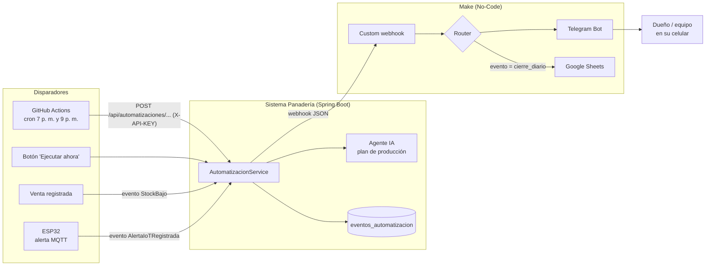
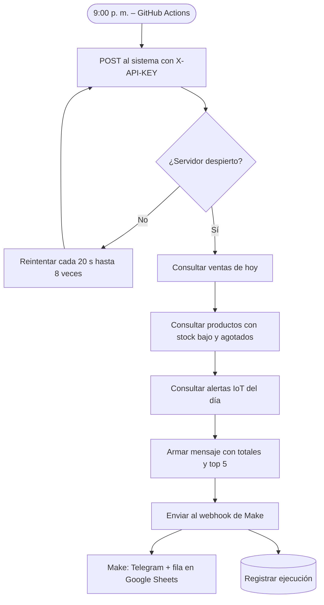
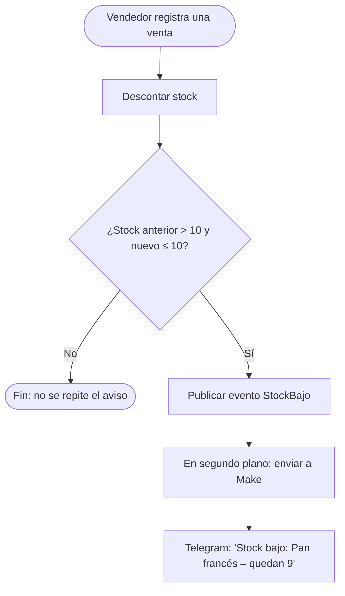
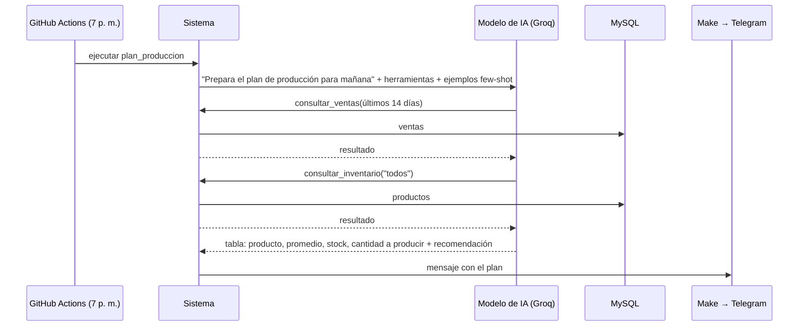

# Avance 4 – Automatización mediante RPA y No-Code/Low-Code

**Proyecto:** Transformación digital de la Panadería Pastelería Los Andes
**Curso:** Herramientas de Desarrollo Profesional TIC
**Integrantes:** _[completar]_ (Grupo 03)

---

## 1. Identificación de procesos repetitivos

Se analizaron las tareas diarias de la panadería para encontrar las que son repetitivas, consumen tiempo y siguen reglas claras (candidatas a automatizar):

| # | Proceso actual (manual) | Frecuencia | Problema | ¿Automatizable? |
|---|---|---|---|---|
| P1 | El dueño revisa las ventas del día y suma totales al cerrar | Diaria | 15–30 min, errores de suma, a veces no se hace | ✅ Reglas fijas |
| P2 | Decidir cuánto pan hornear mañana "por experiencia" | Diaria | Merma o faltantes | ✅ Con IA (datos + criterio) |
| P3 | Revisar qué productos se están acabando | Varias veces al día | Se nota cuando ya no hay producto | ✅ Evento: venta |
| P4 | Vigilar la vitrina, la bandeja y la puerta del almacén | Continua | Nadie mira el dashboard todo el día | ✅ Evento: sensor IoT |
| P5 | Armar el pedido al proveedor copiando datos del reporte de inventario | Semanal | Copiar y pegar entre sistemas | ✅ RPA (propuesta) |

_[Validar frecuencias y tiempos con el dueño de la panadería.]_

## 2. Solución implementada

| Proceso | Automatización | Disparador | Herramientas |
|---|---|---|---|
| P1 | **Reporte de cierre diario** | Programado 9:00 p. m. | GitHub Actions → Sistema → Make → Telegram / Google Sheets |
| P2 | **Agente IA: plan de producción** | Programado 7:00 p. m. | GitHub Actions → Sistema → Agente IA (Groq) → Make → Telegram |
| P3 | **Aviso de stock bajo** | Una venta deja ≤ 10 unidades | Sistema → Make → Telegram |
| P4 | **Alertas IoT** | El ESP32 publica una alerta por MQTT | ESP32 → MQTT → Sistema → Make → Telegram |
| P5 | **Pedido a proveedor (RPA)** | Semanal | Power Automate Desktop (diseño propuesto, sección 5) |

### 2.1 Arquitectura de la automatización

## 3. Diseño de los flujos automatizados

### 3.1 Reporte de cierre diario

### 3.2 Aviso de stock bajo (tiempo real)

El aviso se envía **una sola vez** cuando el producto cruza el mínimo, no en cada venta posterior, y en segundo plano para no demorar la venta.

### 3.3 Alertas IoT (tiempo real)

El ESP32 publica la alerta por MQTT → el sistema la guarda (sin duplicar la misma alerta pendiente durante 10 minutos) → publica el evento `AlertaIoTRegistrada` → se reenvía a Telegram.

## 4. Agente inteligente: plan de producción

A diferencia de un flujo fijo, el agente **decide qué datos necesita** usando *function calling* (Avance 2):

| Característica de agente | Cómo se cumple |
|---|---|
| Autonomía | Elige qué herramientas usar y en qué orden |
| Percepción del entorno | Lee ventas, inventario y sensores IoT reales |
| Razonamiento | Calcula demanda promedio, ajuste de fin de semana y resta el stock |
| Acción | Entrega el plan al equipo por Telegram sin intervención humana |
| Límites de seguridad | Solo lectura: no puede modificar datos |

## 5. Propuesta RPA: pedido semanal al proveedor (Power Automate Desktop)

Proceso de escritorio que hoy se hace copiando y pegando, adecuado para un robot de software:

| Paso | Acción del robot (Power Automate Desktop) |
|---|---|
| 1 | Abrir el navegador e iniciar sesión en el sistema de la panadería |
| 2 | Ir a **Reportes → Stock de productos → Agotado / Stock bajo** y descargar el Excel |
| 3 | Abrir la plantilla de pedido del proveedor (Excel) |
| 4 | Por cada producto con stock bajo, calcular la cantidad a pedir (stock objetivo − stock actual) y escribir la fila |
| 5 | Guardar el pedido como PDF |
| 6 | Enviar el PDF por Outlook/Gmail al proveedor con un mensaje estándar |
| 7 | Registrar la fecha del pedido en una hoja de control |

_[Si el equipo lo implementa: grabar el flujo en Power Automate Desktop (gratuito en Windows 10/11) y adjuntar capturas.]_

## 6. Valor agregado

| Indicador | Antes | Después (esperado) |
|---|---|---|
| Tiempo diario del cierre de caja | _[medir]_ min | 0 min (llega solo al celular) |
| Tiempo en decidir la producción | _[medir]_ min | Plan listo a las 7 p. m. |
| Tiempo de reacción ante stock bajo | Cuando el cliente pregunta | Inmediato |
| Tiempo de reacción ante vitrina caliente o puerta abierta | Cuando alguien lo nota | Inmediato |
| Historial de ventas diarias | No existe | Google Sheets automático |

## 7. Prototipo y evidencias

- Pantalla **Reportes → Automatizaciones** (solo administrador): estado de la configuración, botón *Ejecutar ahora* / *Enviar prueba* y el historial con el texto de cada mensaje.
- Escenario de Make (webhook → router → Telegram / Google Sheets): ver la [guía paso a paso](guia_make_telegram.md).
- Flujo programado: [`.github/workflows/automatizaciones.yml`](../../.github/workflows/automatizaciones.yml).
- 7 pruebas automáticas nuevas (34 en total), con un servidor que simula el webhook de Make.

_[Insertar capturas: escenario de Make, mensajes recibidos en Telegram, hoja de Google Sheets, ejecución en GitHub Actions y pantalla de automatizaciones.]_

## 8. Referencias

- Make. *Webhooks* y *Telegram Bot* modules. https://www.make.com/en/help
- Telegram. *Bots: An introduction for developers*. https://core.telegram.org/bots
- GitHub. *Events that trigger workflows – schedule*. https://docs.github.com/actions
- Microsoft. *Power Automate Desktop documentation*. https://learn.microsoft.com/power-automate/desktop-flows/
