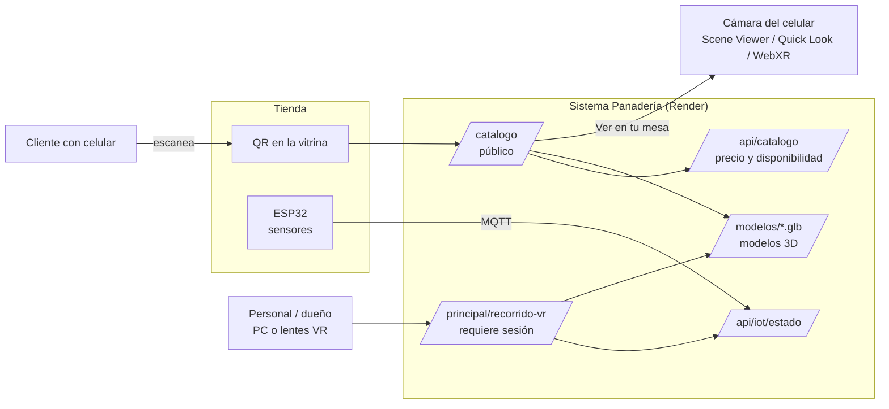
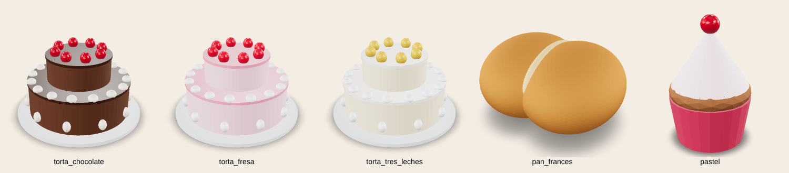
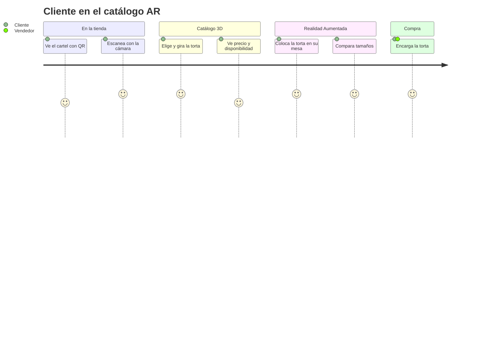
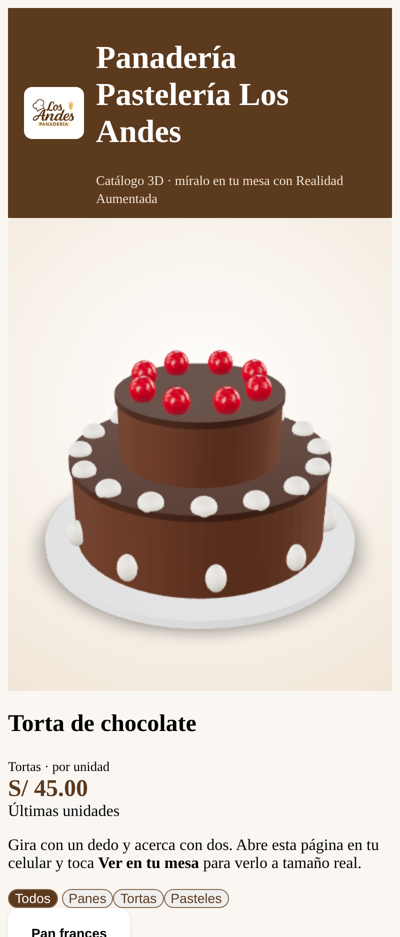
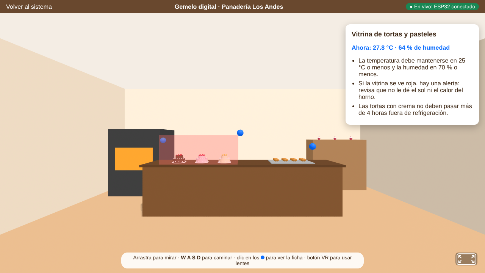

# Avance 5 – AR, VR y Metaverso

**Proyecto:** Transformación digital de la Panadería Pastelería Los Andes
**Curso:** Herramientas de Desarrollo Profesional TIC
**Integrantes:** _[completar]_ (Grupo 03)

---

## 1. Casos de uso

| # | Experiencia | Usuario | Problema que resuelve | Tecnología |
|---|---|---|---|---|
| CU1 | **Catálogo de tortas en Realidad Aumentada** | Clientes | Al encargar una torta, el cliente no puede imaginar su tamaño ni cómo se verá en su mesa; solo hay fotos | WebAR con `<model-viewer>` (Google) |
| CU2 | **Gemelo digital de la panadería en VR** | Personal nuevo, dueño | La capacitación del personal nuevo es verbal; el dueño no puede ver el estado de la tienda cuando no está | WebXR con A-Frame + datos IoT en vivo |

**Por qué AR para clientes y VR para el personal:** la AR se usa en el celular del cliente, sin instalar nada y en segundos (escaneando un QR). La VR permite recorrer un espacio completo y es adecuada para capacitación y supervisión, donde el usuario dedica más tiempo.

## 2. Diseño conceptual

### 2.1 Modelos 3D

Los modelos se generan por código con [`herramientas/generar_modelos_3d.py`](../../herramientas/generar_modelos_3d.py) (Python + trimesh), en **tamaño real** y formato **GLB** (glTF binario, estándar para AR web):

| Modelo | Medidas reales | Peso | Se asigna a |
|---|---|---|---|
| `torta_chocolate.glb` | 30 × 17 cm | ~100 KB | Tortas con "chocolate", "selva negra" o "brownie" en el nombre |
| `torta_fresa.glb` | 30 × 17 cm | ~100 KB | Tortas con "fresa", "frutilla" o "frambuesa" |
| `torta_tres_leches.glb` | 30 × 17 cm | ~100 KB | Otras tortas |
| `pan_frances.glb` | 11 × 6 cm | ~150 KB | Categoría Panes |
| `pastel.glb` | 7 × 11 cm | ~13 KB | Categoría Pasteles y otros |

> Mejora futura: reemplazar los modelos geométricos por modelos fotogramétricos de los productos reales (capturados con el celular en apps como Polycam o KIRI Engine), sin cambiar el código.

## 3. Storyboard

### 3.1 CU1 – Cliente que encarga una torta (Realidad Aumentada)

| Escena | Qué pasa | Qué ve el cliente |
|---|---|---|
| 1. Vitrina | María quiere una torta para el cumpleaños de su hijo, pero en la vitrina no está la de fresa | Un cartel: *"¡Mira nuestras tortas en tu mesa!"* con un código QR |
| 2. Escanea | Apunta la cámara de su celular al QR | Se abre el catálogo 3D de Los Andes, sin instalar ninguna app |
| 3. Explora | Toca "Torta de fresa" y la gira con el dedo | La torta en 3D, el precio (S/ 48.00) y si está disponible hoy |
| 4. AR | Toca **Ver en tu mesa** y apunta a la mesa de la tienda | La torta aparece sobre la mesa **a tamaño real** (30 cm) |
| 5. Decide | Se da cuenta de que alcanza para su mesa de 8 personas | Compara con la de chocolate cambiando de producto |
| 6. Compra | Encarga la torta al vendedor | El vendedor registra la venta en el sistema; la disponibilidad del catálogo se actualiza sola |

### 3.2 CU2 – Capacitación de un vendedor nuevo (VR / gemelo digital)

| Escena | Qué pasa | Qué ve el empleado |
|---|---|---|
| 1. Inicio | Luis entra a trabajar; el dueño le pide hacer el recorrido de inducción | En el sistema: menú **IoT y 3D → Recorrido VR** |
| 2. Recorre | Camina por la panadería virtual con el mouse y W A S D (o con lentes VR) | Mostrador, vitrina con tortas, bandeja de pan, horno, almacén y entrada |
| 3. Aprende | Toca los **puntos azules** | Fichas de capacitación: rangos de temperatura, cuándo reponer pan, normas del horno y del almacén |
| 4. Datos reales | La vitrina virtual se pone **roja** | Ficha: *"Ahora: 27.8 °C"*, el mismo dato del ESP32 de la tienda real |
| 5. Supervisión | El dueño, desde su casa, abre el recorrido | Ve la puerta del almacén abierta y la bandeja casi vacía, como en la tienda en ese momento |

## 4. Interacciones propuestas

### 4.1 Catálogo AR (celular)

| Interacción | Gesto / acción | Resultado |
|---|---|---|
| Girar el producto | Arrastrar con un dedo | Rotación 360° del modelo |
| Acercar / alejar | Pellizcar con dos dedos | Zoom |
| Cambiar de producto | Tocar una tarjeta de la lista | Se carga otro modelo 3D con su precio |
| Filtrar | Tocar *Panes*, *Tortas* o *Pasteles* | Lista filtrada |
| Ver en su mesa | Botón **Ver en tu mesa** | Abre la cámara: Scene Viewer (Android), Quick Look (iPhone) o WebXR |
| Colocar y mover en AR | Tocar la superficie y arrastrar | La torta queda fija sobre la mesa a escala real (`ar-scale="fixed"`) |

### 4.2 Gemelo digital VR

| Interacción | En PC | Con lentes VR (Meta Quest, etc.) |
|---|---|---|
| Mirar | Arrastrar el mouse | Girar la cabeza |
| Caminar | Teclas W A S D | Joystick |
| Abrir una ficha | Clic en un punto azul | Apuntar con el control (láser) y presionar el gatillo |
| Entrar en VR | — | Botón de VR (abajo a la derecha) |

**Comportamiento en vivo (cada 5 segundos, desde el ESP32):**

| Dato real | Reflejo en la escena |
|---|---|
| Temperatura o humedad de la vitrina fuera de rango | El vidrio de la vitrina se pone rojo y el texto cambia de color |
| Peso de la bandeja | Cantidad de panes 3D visibles en la bandeja (hasta 12) |
| Puerta del almacén abierta | La puerta virtual se abre (animación) |
| Clientes detectados por el PIR | Contador sobre la entrada |
| ESP32 desconectado | Indicador "ESP32 sin conexión (últimos datos)" |

## 5. Aplicación tecnológica

| Decisión | Elección | Justificación |
|---|---|---|
| AR | `<model-viewer>` 3.5 (Google) | Funciona en el navegador; usa la AR nativa de cada celular (ARCore/Scene Viewer en Android, ARKit/Quick Look en iPhone) sin instalar apps |
| VR | A-Frame 1.6 (WebXR) | Escenas 3D con HTML; funciona en PC, celular y lentes VR desde el mismo enlace |
| Formato 3D | glTF / GLB | Estándar abierto de Khronos, liviano y compatible con AR y VR |
| Datos | API del sistema (`/api/catalogo`, `/api/iot/estado`) | Precio, disponibilidad y sensores **en vivo**, sin duplicar información |
| Seguridad | Catálogo público sin el stock exacto; recorrido VR solo con sesión | El cliente ve lo necesario; los datos internos quedan protegidos |
| QR | ZXing, generado por el sistema con la dirección pública | El cartel siempre apunta al servidor correcto (local o nube) |

### 5.1 Hacia el Metaverso (propuesta)

El gemelo digital es la base para un espacio compartido:

1. **Sala multiusuario:** con el componente `networked-aframe`, el dueño y los empleados entrarían al mismo tiempo con avatares (inducción a distancia).
2. **Tienda virtual en Spatial o Frame:** publicar la escena para que los clientes recorran la panadería y hagan pedidos.
3. **Eventos:** talleres virtuales de decoración de tortas para clientes.

## 6. Prototipo y maqueta visual

| Recurso | Enlace |
|---|---|
| Catálogo AR (público) | https://sistema-panaderia-los-andes.onrender.com/catalogo |
| Cartel QR para imprimir | https://sistema-panaderia-los-andes.onrender.com/catalogo/qr |
| Recorrido VR (con sesión) | Sistema → **IoT y 3D → Recorrido VR** |

**Catálogo AR en un celular** (precio y disponibilidad desde el sistema):

**Gemelo digital:** la vitrina en rojo porque el ESP32 reportó 27.8 °C, con 8 panes en la bandeja según el peso y la ficha de capacitación abierta:

_[Insertar capturas tomadas en un celular real: el catálogo, la torta colocada sobre una mesa en AR y el cartel QR impreso.]_

## 7. Integración con los avances anteriores

| Avance | Integración |
|---|---|
| 1 – DevOps | 4 pruebas automáticas nuevas (38 en total), despliegue automático en Render |
| 2 – IA | El asistente y el catálogo usan los mismos datos de productos |
| 3 – IoT | El gemelo digital muestra en vivo los sensores del ESP32 |
| 4 – Automatización | Las fichas de la VR explican las alertas que llegan por Telegram |

## 8. Referencias

- Google. *model-viewer documentation*. https://modelviewer.dev
- A-Frame. *Documentation*. https://aframe.io/docs
- Khronos Group. *glTF 2.0 Specification*. https://www.khronos.org/gltf
- W3C. *WebXR Device API*. https://www.w3.org/TR/webxr/
